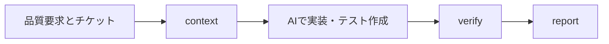

# DQD 宣言的品質開発

品質要求とチケットからAIに渡すContextを作り、実装後のテスト結果を品質IDごとに確認するCLIです。



## すぐ試す

Go 1.27.3とmakeを用意し、DQDリポジトリのルートで実行します。

```sh
make validate PROJECT=docs/example
make context PROJECT=docs/example TICKET_ID=TICKET-001 ARGS=-stdout
```

| やりたいこと | 次に読むページ |
| --- | --- |
| 自分の品質要求を書いて始める | [導入ガイド](docs/GETTING_STARTED.md) |
| サンプルでTODOを実装する | [TODOサンプル](docs/example/README.md) |
| 設定項目を調べる | [リファレンス一覧](docs/GETTING_STARTED.md#定義項目を調べる) |
| コマンドのフラグや出力先を調べる | [コマンドリファレンス](docs/reference/commands/README.md) |
| CLIの処理を知る | [内部設計](docs/design/OVERVIEW.md) / [設計メモ](docs/design/DECISIONS.md) |

## makeなしで使う

リポジトリのルートで `bin/dqd` にビルドします。ビルド済みなら最後の行から実行できます。

```sh
mkdir -p bin
go -C pkg build -o "$PWD/bin/dqd" ./cmd/dqd
./bin/dqd -C docs/example validate
```

`-C` は `requirements.yml` のあるディレクトリです。`init` の場合は作成先の親を指します。省略時は現在のディレクトリを使います。フラグはチケットIDなどの位置引数より前に置きます。

## コマンド一覧

全9コマンドの引数と実行例は [コマンドリファレンス](docs/reference/commands/README.md) にあります。端末で一覧を見るには `make help` または `./bin/dqd -h` を使います。

CLIを変更したら `make check` でGoのテストと静的解析、`make fmt` で整形します。
