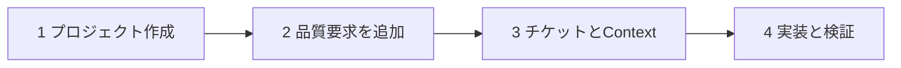

# DQDを使い始める

Go 1.27.3とmakeを用意し、DQDリポジトリのルートで実行します。品質要求を書かずに試すなら [TODOサンプル](example/README.md) へ進んでください。



## 1 プロジェクトを作る

```sh
make init ARGS="-name todo-app"
```

`todo-app/` に品質要求、チェック未登録の `verification.yml`、`tickets/`、`verifies/`、`reports/` ができます。作成済みの名前は使えません。

## 2 品質要求を追加する

最初からある共通要求 `CM-001` を残し、`todo-app/requirements.yml` の `requirements` 配列の末尾に追記します。`explicit` はチケットからIDを指定したときに適用します。

```yaml
  - id: UI-001
    name: レスポンシブ対応
    domain: frontend
    characteristic: interaction_capability
    document:
      path: quality/frontend.md
      section: UI-001
    applicability:
      mode: explicit
    verification:
      type: automated
      method: e2e
```

参照先の `todo-app/quality/frontend.md` を作ります。

```markdown
# フロントエンドの品質要求

## UI-001：レスポンシブ対応

### 品質要求

画面サイズが変わっても表示・操作できること。

### 共通合格基準

- 意図しない横スクロールがない。
- 入力欄と操作ボタンが見え、重ならずに操作できる。

### 検証方法

E2Eテストで対象画面の表示と操作を確認する。
```

## 3 チケットからContextを作る

```sh
make ticket-new PROJECT=todo-app TICKET_ID=TICKET-001 ARGS='-title "TODOの追加" -domains frontend -include UI-001'
```

`todo-app/tickets/TICKET-001.md` の先頭のYAMLを残し、本文を書き換えます。[AIに下書きを頼む例](reference/tickets.md#aiと下書きを作る)

```markdown
# 機能要件

入力欄と追加ボタンを作る。ボタンまたはEnterキーでTODOを登録し、登録順に表示する。
空の一覧には「TODOはまだありません」と表示する。

# 個別合格条件

## UI-001

- 375px、768px、1440pxの各表示幅で、横スクロールなしに入力・追加できる。
```

```sh
make validate PROJECT=todo-app
make resolve PROJECT=todo-app TICKET_ID=TICKET-001
make context PROJECT=todo-app TICKET_ID=TICKET-001
```

`resolve` で `CM-001` と `UI-001` を確認します。Contextの保存先は `todo-app/.dqd/contexts/TICKET-001.md` です。表示のみなら `ARGS=-stdout`、書き直した後の再生成は `ARGS=-force` を使います。

## 4 実装してレポートを開く

1. ContextをAIへ渡し、実装、合格条件に対応するテスト、品質IDごとの実行コマンドを依頼します。チームが決めた言語やフレームワークは、チケットの `## 前提` や依頼文に書きます。未決定なら着手前に相談するよう伝えます。
2. `todo-app/verification.yml` に、手元で動くテストコマンドと、そのテストで確認する品質IDを登録します。[入力例](reference/verification.md#ファイルの雛形)
3. 次を実行し、`todo-app/reports/TICKET-001.html` をブラウザーで開きます。

```sh
make verify PROJECT=todo-app TICKET_ID=TICKET-001
make report PROJECT=todo-app TICKET_ID=TICKET-001 ARGS=-details
```

- テスト未登録の要求は「未確認」です。結果が保存されていれば、`verify` がエラー終了した後も `report` を実行できます。
- `ARGS=-details` はMakeに渡す指定で、HTMLにコマンドとログを載せます。目視で確認した結果は別に記録します。
- 実装やテストを直したら `verify` と `report` を再実行します。次の機能は新しいチケットで進めます。

## 定義項目を調べる

| ファイル | 書く内容 |
| --- | --- |
| [requirements.yml](reference/requirements.md) | 品質ID、適用条件、本文の参照先 |
| [quality/*.md](reference/quality-documents.md) | 品質要求、共通合格基準、検証方法 |
| [tickets/*.md](reference/tickets.md) | 機能要件と今回の合格条件 |
| [verification.yml](reference/verification.md) | 品質IDとテストコマンドの対応 |

フラグと出力先は [コマンドリファレンス](reference/commands/README.md) を参照してください。
