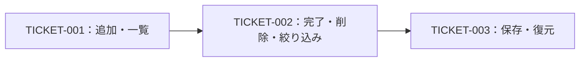

# TODOリストを3枚のチケットで作る

同じ作業フォルダで、チケットごとにContextの生成、実装、検証を繰り返します。



## コピーせずに試す

Go 1.27.3とmakeを用意し、DQDリポジトリのルートで実行します。

```sh
make validate PROJECT=docs/example
make resolve PROJECT=docs/example TICKET_ID=TICKET-001
make context PROJECT=docs/example TICKET_ID=TICKET-001 ARGS=-stdout
```

`validate` は `5 requirements, 3 tickets`、`resolve` は `CM-001`、`UI-001`、`FE-001` を表示します。Contextは標準出力で確認できます。

## 1 作業用プロジェクトを作る

```sh
make init ARGS="-name todo-demo"
cp docs/example/requirements.yml todo-demo/requirements.yml
cp docs/example/verification.yml todo-demo/verification.yml
cp docs/example/quality/*.md todo-demo/quality/
cp docs/example/tickets/*.md todo-demo/tickets/
make validate PROJECT=todo-demo
```

同名フォルダがある場合は、新しい名前に読み替えます。入力は [requirements.yml](requirements.yml)、[verification.yml](verification.yml)、[品質要求](quality/)、[チケット](tickets/) です。

## 2 チケットを順に実装する

| 順番 | チケット | 各チケットで確認する要求 |
| --- | --- | --- |
| 1 | [入力と一覧表示](tickets/TICKET-001.md) | CM-001、UI-001、FE-001 |
| 2 | [完了切り替え・削除・絞り込み](tickets/TICKET-002.md) | CM-001、UI-001、FE-002 |
| 3 | [保存と復元](tickets/TICKET-003.md) | CM-001、UI-001、FE-003 |

```sh
make context PROJECT=todo-demo TICKET_ID=TICKET-001
```

`todo-demo/` をAIエージェントで開き、`.dqd/contexts/TICKET-001.md` に従った実装とテストを依頼します。適用する品質IDについて、`verification.yml` に対応する npm スクリプトを `package.json` に用意するよう伝えてください。手動で確認する項目も聞きます。

## テスト結果をレポートで見る

1. 対象チケットの npm スクリプトが作業フォルダで動くことを確認します。TICKET-001で使うのは `test:regression`、`test:layout`、`test:input` です。次のチケットでは既存の回帰テストを引き継ぎ、その時点で実装済みの機能を確認します。
2. 次を実行し、`todo-demo/reports/TICKET-001.html` をブラウザーで開きます。

```sh
make verify PROJECT=todo-demo TICKET_ID=TICKET-001
make report PROJECT=todo-demo TICKET_ID=TICKET-001 ARGS=-details
```

サンプルはコマンドの対応表です。スクリプトやテストは作業フォルダで用意します。別のコマンドでテストする場合は、コピーした [verification.yml](../reference/verification.md) を編集してください。

`verify` がエラー終了しても、結果が保存されていればHTMLを作れます。`ARGS=-details` を付けるとコマンドとログが載ります。目視した結果は別に記録します。

確認が済んだら、同じ `todo-demo/` で `TICKET_ID` を次のIDに変え、Context生成から繰り返します。チケットや品質要求を直した場合は `make context PROJECT=todo-demo TICKET_ID=TICKET-001 ARGS=-force` のように更新します。
