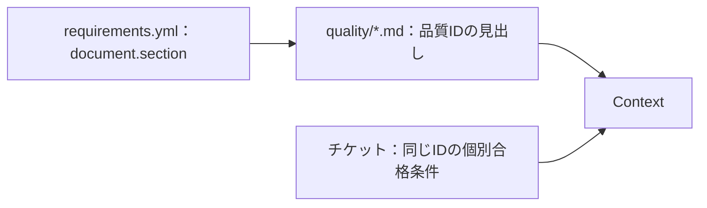

# 品質要求Markdown

`quality/*.md` に、複数のチケットで使う品質要求と合格基準を書きます。



## ファイルの雛形

`quality/frontend.md` の例です。[requirements.ymlの雛形](requirements.md#ファイルの雛形) と組み合わせます。

```markdown
# フロントエンドの品質要求

## UI-001：レスポンシブ対応

### 品質要求

画面サイズが変わっても表示・操作できること。

### 共通合格基準

- 意図しない横スクロールがない。
- 入力欄と操作ボタンが見え、重ならずに操作できる。

### 検証方法

E2Eテストで画面の表示と操作を確認する。
```

| 書く場所 | 内容 |
| --- | --- |
| 品質要求 | 満たすべき振る舞い |
| 共通合格基準 | すべての適用先で確認する条件 |
| 検証方法 | 何をテストや目視で確かめるか |
| チケットの個別合格条件 | 今回の画面・値。例「375px、768px、1440pxでも操作できる」 |
| [verification.yml](verification.md) | 実行するテストコマンド |

上の3つの小見出しは推奨です。「使いやすいこと」など曖昧な基準は、目で見て確認できる条件にします。

## 見出しとファイルのルール

- 参照先は `## UI-001：名前`、`## UI-001:名前`、`## UI-001` のいずれか。重複、参照先の欠落、空の本文はエラーです。
- CLIは該当見出しから次の同じ階層以上の見出しまでを抽出します。Contextでは見出しを1段深くします。変換後はレベル6までです。
- UTF-8で記述し、改行はLFまたはCRLF。バッククォートやチルダで囲ったコード中の見出しは対象外です。コードブロックは閉じてください。
- 領域ごとに `quality/common.md`、`quality/frontend.md`、`quality/backend.md` などへ分けられます。

要求を修正したら `context -force TICKET-001` で該当Contextを更新し、テストも見直します。
