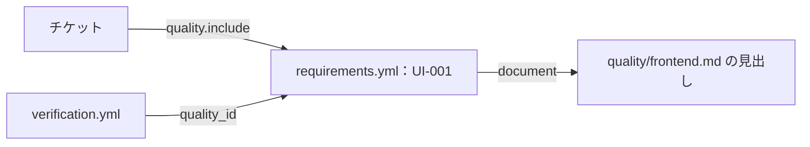

# requirements.yml

プロジェクト直下に置き、品質ID、本文の参照先、適用条件、検証の種類を登録します。



## ファイルの雛形

既存ファイルへ追加する場合は、`requirements` 配列に `- id:` から追記します。

```yaml
schema_version: 1

requirements:
  - id: UI-001
    name: レスポンシブ対応
    domain: frontend
    characteristic: interaction_capability
    document:
      path: quality/frontend.md
      section: UI-001
    applicability:
      mode: explicit
    verification:
      type: automated
      method: e2e
```

対応する雛形は [品質要求Markdown](quality-documents.md#ファイルの雛形) と [チケット](tickets.md#ファイルの雛形) にあります。

## 定義項目

`schema_version` は整数の `1`、`requirements` は1件以上の配列です。

| 要求ごとの項目 | 指定する値 |
| --- | --- |
| `id` | 重複しない品質ID。例 `UI-001` |
| `name` | 要求名 |
| `domain` | 技術領域。例 `common`、`frontend`、`backend`、`database`、`infrastructure` |
| `characteristic` | 品質特性。例 `functional_suitability`、`performance_efficiency` |
| `document.path` | プロジェクト内の `.md` 相対パス |
| `document.section` | 参照先のレベル2見出しにあるID |
| `applicability.mode` | `always`、`automatic`、`explicit` |
| `applicability.attributes` | `automatic` は1要素の文字列配列。他は省略または `[]` |
| `verification.type` | `automated` |
| `verification.method` | 検証方法。例 `unit`、`integration`、`e2e` |

- `attributes` を除きすべて必須です。文字列は空でない1行、IDと `section` は英字で始まる英数字・`-`・`_` です。
- 未定義の項目、重複キー、型違い、エイリアス、複数のYAML文書はエラーです。
- `domain` と `characteristic` は自由記述です。チケットの `domains` で要求は絞り込みません。

## 適用条件

| モード | 適用する条件 |
| --- | --- |
| `always` | すべてのチケット |
| `automatic` | チケットの `attributes` に指定の属性がある |
| `explicit` | チケットの `quality.include` に品質IDがある |

```yaml
applicability:
  mode: automatic
  attributes: [screen]
```

`quality.include` ではどのモードも明示指定できます。重複した要求は1件にまとめ、`requirements.yml` の記載順で扱います。

## 検証方法

`verification.method` はContextとHTMLに表示する値です。実行するコマンドは [verification.yml](verification.md) の `quality_id` で対応付けます。

[複数の品質要求を登録した例](../example/requirements.yml)
