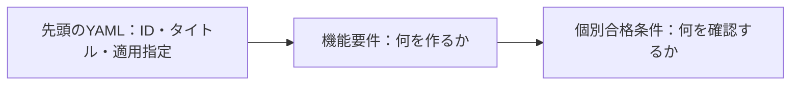

# チケットの書き方

`tickets/チケットID.md` に、今回の機能と個別合格条件を書きます。



## ファイルの雛形

`UI-001` は先に [requirements.yml](requirements.md#ファイルの雛形) に登録します。

```markdown
---
id: TICKET-001
title: TODOの追加と一覧表示
domains: [frontend]
attributes: []
quality:
  include: [UI-001]
---

# 機能要件

追加ボタンまたはEnterキーでTODOを登録し、登録順に表示する。

# 個別合格条件

## UI-001

- 375px、768px、1440pxの各表示幅で、横スクロールなしに入力・追加できる。
```

## YAMLの定義項目

| 項目 | 必須 | 指定する値 |
| --- | --- | --- |
| `id` | 必須 | ファイル名と同じID。英字で始まる英数字・`-`・`_` |
| `title` | 必須 | 空でない1行のタイトル |
| `domains` | 任意 | 変更対象の領域。分類用で、要求の選択やContext本文には使わない |
| `attributes` | 任意 | [自動適用](requirements.md#適用条件)に使う属性 |
| `quality.include` | 任意 | 明示追加する登録済み品質ID |

任意項目の値は文字列の配列です。省略時は空扱い。空の値、前後に空白のある値、重複はエラーです。

## 品質要求を追加する

`always`、属性の一致、`quality.include` を合わせて要求を選びます。個別合格条件にIDを書くだけでは要求は追加されません。適用が0件になるとエラーです。初期設定の `CM-001` は常時適用です。

## 本文の構成

- `# 機能要件` と `# 個別合格条件` は各1つ。本文はこのどちらかの見出しから始めます。
- 機能要件は空にせず、技術構成や既存コードの制約は必要に応じて `## 前提` に書きます。
- 個別合格条件には、今回の画面・値・測定条件を書きます。`## UI-001` のように適用済みのIDだけを見出しにし、重複を避けて本文を添えます。個別条件がなければセクション全体の本文を空にできます。
- Contextでは見出しが機能要件で1段、個別合格条件の本文で2段深くなります。変換後はレベル6までです。

共通基準は [品質要求Markdown](quality-documents.md) に、実行コマンドは [verification.yml](verification.md) に書きます。

## コマンドで雛形を作る

```sh
make ticket-new PROJECT=todo-app TICKET_ID=TICKET-001 ARGS='-title "TODOの追加" -domains frontend -include UI-001'
```

作成後は本文を書き換えます。同名ファイルがある場合はエラーです。[TODOのチケット例](../example/tickets/TICKET-001.md)

## AIと下書きを作る

人は「何を、誰が、どうできれば終わりか」と、決まっている制約を短く書きます。操作の失敗や空の状態も、分かる範囲で伝えます。雛形は `ticket new` で作り、AIには本文を具体化してもらいます。

```text
対象: tickets/TICKET-001.md
依頼: 利用者がTODOを追加し、一覧で確認できるようにしたい。
既知の条件: 空白だけの入力では追加せず、理由を画面に表示する。
適用する品質IDとその基準: resolveの結果と対応する品質要求Markdownを参照する。

先頭のYAMLを維持し、「# 機能要件」と「# 個別合格条件」の本文を書いてください。
機能要件は操作と結果、個別合格条件は確認できる具体例で書いてください。
個別合格条件は適用済みの品質IDだけを「## 品質ID」として使ってください。
言語や上限値など未決定の項目は推測せず、確認したい点を別に返してください。
```

形式とIDは `validate` と `resolve` で揃えられます。要件の中身は入力やAIによって変わるため、チームで「操作と期待結果が確認できるか」「書いていない仕様を足していないか」をレビューします。
