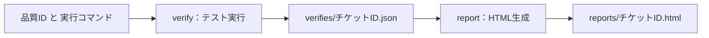

# verification.yml

**すでに実行できるテストを、品質IDに結び付ける設定**です。プロジェクト直下、`requirements.yml` の隣に置きます。`init` 直後は `checks: []` です。



## ファイルの雛形

1. `requirements.yml` で、テストが確かめる品質IDを確認します。
2. テストがどのフォルダで、どのコマンドで動くかを手元で確認します。
3. `checks` に1件追加します。下はプロジェクト直下で `npm run test:layout` が動き、`UI-001` を確かめられる場合の例です。

```yaml
schema_version: 1
checks:
  - id: layout
    quality_id: UI-001
    command: ["npm", "run", "test:layout"]
```

| 項目 | 書く値 |
| --- | --- |
| `schema_version` | 整数の `1` |
| `checks` | チェックの一覧。未登録なら `[]` |
| `id` | チェック名。設定内で一意、英字で始まる英数字・`-`・`_` |
| `quality_id` | 確認する登録済みの品質ID。同じIDに複数のチェックを登録可能 |
| `directory` | 任意。コマンドを実行する相対パス。省略時はプロジェクト直下 |
| `command` | 実行ファイルと引数を1要素ずつ並べる。パイプなどが必要ならスクリプト側に書く |

この例では、プロジェクト直下の `package.json` に `test:layout` が必要です。`frontend/package.json` にある場合は同じチェックに `directory: frontend` を足します。自分のテストコマンドに置き換えたら、`validate` で書式と品質IDを確認します。

同じ品質IDが複数のチケットに適用される場合、登録した同じチェックがそれぞれで動きます。たとえば常時適用の `CM-001` には、その時点の実装で動く回帰テストを登録します。

## 実行と合否

| チェック結果 | 表示 | JSONの `status` |
| --- | --- | --- |
| 終了コード `0` | 合格 | `passed` |
| 終了コード `77` | 未確認（スキップ） | `unverified` |
| その他の非ゼロ終了コード | 不合格 | `failed` |
| 起動失敗・タイムアウトなど | 実行エラー | `error` |

`verify` はチケットに適用する要求のチェックを実行します。全部合格した要求だけが合格で、未登録は未確認です。複数の状態があれば実行エラー → 不合格 → 未確認を優先します。テストが0件のときにランナーが合格を返さないよう設定してください。目視確認は別に記録します。

## レポートを開く

```sh
make verify PROJECT=todo-app TICKET_ID=TICKET-001
make report PROJECT=todo-app TICKET_ID=TICKET-001 ARGS=-details
```

**`ARGS=-details` は `make report` を実行するときの指定**です。実行ファイルを直接使う場合は `./bin/dqd -C todo-app report -details TICKET-001` と書きます。詳細付きの `todo-app/reports/TICKET-001.html` に、コマンド、作業ディレクトリ、ログが載ります。通常表示は `-details` を省略します。[reportの全フラグ](commands/report.md)

## ファイルの保存と公開範囲

| コマンド | 保存先 |
| --- | --- |
| `verify` | `todo-app/verifies/TICKET-001.json` |
| `report` | `todo-app/reports/TICKET-001.html` |

- 保存期限はありません。同じチケットを再実行すると各ファイルを上書きし、不要になった結果は手元で削除できます。
- 各フォルダの `.gitignore` は、新しく生成する結果を通常のGit追加対象から除外します。すでに追跡済みのファイルをGitから外す操作は別途必要です。
- Unix系では新規フォルダを `0700`、結果ファイルを `0600` で作ります。Windowsではプロジェクトのアクセス権を引き継ぎます。
- HTMLは外部リソースや計測を使わず、ログを文字列として表示します。ログはチェックごとに標準出力と標準エラーを合わせて先頭32 KiBまで記録します。
- 旧版のキャッシュにある結果は、プロジェクト内にJSONがない場合に読み込みます。新しい成果物は上のフォルダに作ります。旧版のキャッシュ自体に自動削除期限はありません。
